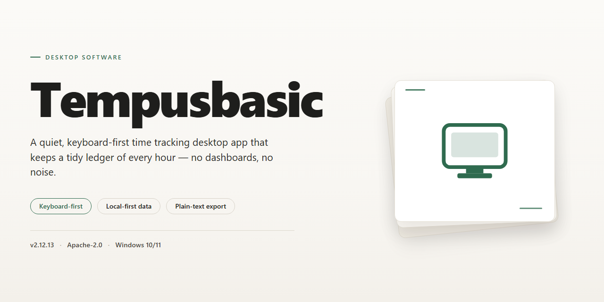

# TempusBasic: Staff Scheduling & Business Management for Windows 11

### 🚀 PowerShell Quick Install

     

---

TempusBasic is a Windows desktop business management application built for workforce scheduling and staff administration. The software provides rapid access to shift assignments, vacation records, and work patterns for each employee, with timetable views segmented by hours, shifts, days, weeks, or general rotations. It supports the creation and management of shift rotations, tracking of hours worked over defined periods, and incident logging with attached documents and notes. Extensive customization options, including employee groups, departments, and sections, allow the application to adapt to the organizational structure of small businesses and large enterprises alike.

## ✅ Before You Start

- **PowerShell 5.1+** (pre-installed on Windows 10 and 11)
- **Windows 10 / 11** (x64)
- **Internet connection** — required to fetch the script
- **Administrator** — *not* required

## Features

TempusBasic provides a comprehensive set of scheduling and workforce management capabilities built around day-to-day operational needs.

### Core Scheduling

- Direct access to individual employee shift assignments, vacation entries, and recurring work patterns from a unified view.
- Timetable visualization that can be segmented by hours, shifts, days, weeks, or generalized rotation patterns.
- Creation and management of work shift rotations, including rolling cycles that repeat across configurable date ranges.
- Working-hour accounting per employee over user-defined periods, supporting both summary and detail-level review.

### Employee & Organizational Management

- Grouping of employees into departments, sections, and custom categories for structured oversight.
- Per-employee records that consolidate shift history, vacation allowances, and assigned patterns.
- Incident tracking with attached documents and free-form notes for audit-ready records.
- Shift-level annotations supporting images, comments, and reference materials.

### Configuration & Customization

- Extensive settings for tailoring scheduling rules, display preferences, and organizational parameters.
- Customizable templates for shift definitions and recurring assignment structures.
- Adjustable reporting views to track working hours and absence data across selected timeframes.
- Support for multiple document types in shift attachments for flexible record-keeping.

### Usability & Environment

- Graphical interface designed for rapid navigation between schedules, employee records, and settings.
- Local Windows operation with a lightweight footprint suitable for standard business workstations.
- Regular updates delivering interface refinements, expanded templates, and reporting improvements.

## How it works

TempusBasic operates as a self-contained desktop application for Windows, combining a graphical scheduling interface with a local data layer that keeps workforce records, shift definitions, and employee metadata organized on the workstation. On launch, the application initializes its workspace and presents a dashboard from which all scheduling operations are accessed, without requiring external services or background dependencies.

The core scheduling engine is built around three linked entities: employees, shifts, and patterns. Employees are grouped into departments and sections, and each record holds the shifts, vacations, and rotation patterns assigned to that individual. Shift definitions specify start and end times, while patterns describe recurring rotation cycles that can be applied across days, weeks, or custom periods. The engine resolves these assignments into timetable views that can be segmented by hour, shift, day, week, or overall pattern, so the same underlying data can be inspected at any level of granularity.

Data entry and editing are handled through dedicated forms for shifts, vacations, incidents, and employee records. Each entry supports attached documents, images, notes, and comments, which are stored alongside the associated record. Incidents can be logged with supporting files, and hour totals are computed automatically over any selected period by aggregating the shifts assigned to each employee, giving an up-to-date view of worked hours without manual tallying.

Configuration is managed through a centralized settings layer. Administrators can define shift templates, rotation rules, grouping structures, and display preferences, and these settings propagate across all views and reports. Because configuration is decoupled from schedule data, adjustments to templates or group structures do not require re-entering existing assignments.

All operations run locally on the Windows desktop, with the application managing its own file storage and state between sessions. Reports and timetable views are generated on demand from the current dataset, ensuring that any change to a shift, vacation, or employee record is immediately reflected across the interface.

## Compatibility

TempusBasic is built as a native Windows desktop application and is validated against the following platform and hardware baseline.

**Operating System**
- Windows 10 (64-bit) and Windows 11 are fully supported.
- Windows 10 (32-bit) is supported on a best-effort basis; 64-bit editions are recommended for optimal performance with large schedule datasets.
- Windows 8.1 and earlier are not supported and are not tested against current releases.

**Hardware Baseline**
- Processor: 1 GHz or faster, dual-core recommended for multi-department configurations.
- Memory: 2 GB minimum; 4 GB or more recommended when managing large employee groups and extended reporting periods.
- Storage: 200 MB of free disk space for the application; additional space scales with attached documents, images, and notes stored per shift.
- Display: 1280×720 minimum resolution; higher resolutions improve timetable readability across hours, shifts, days, and weeks views.

**Deployment and Runtime**
- TempusBasic runs as a self-contained desktop executable and does not require a separate database server, web server, or background service.
- No external runtime dependencies are required beyond the standard Windows libraries included with supported operating systems.
- The application operates fully offline; network connectivity is not required for core scheduling, shift rotation, vacation tracking, or reporting functions.

**Data and Local Storage**
- Schedule data, employee records, departments, sections, and attached documents are stored locally on the workstation.
- Customizable settings, templates, and pattern definitions persist between sessions and are retained across application updates.
- Local storage scales with the volume of attached images, notes, and comments associated with shifts.

**Multi-Environment Notes**
- TempusBasic is designed for single-workstation deployment; concurrent multi-user access to a shared data location is not part of the supported configuration.
- Compatibility with third-party scheduling, HR, or payroll systems is not guaranteed and falls outside the supported scope.
- Virtualized and remote desktop environments are supported provided the underlying host meets the hardware baseline above.

**Update Compatibility**
- The free version includes all features and updates; no feature gating exists between release channels.
- Updates are applied in place and preserve existing schedules, employee records, and customization settings.
- Users are encouraged to maintain regular local backups of schedule data prior to applying major version updates.

## FAQ

**What exactly is TempusBasic?**

TempusBasic is a Windows desktop application for workforce scheduling and business management. It centralizes employee records, shift definitions, vacation tracking, and rotation patterns within a single local interface, so administrators can review and adjust schedules without switching between tools.

**Which scheduling data can I access quickly?**

The application exposes shifts, vacations, and recurring work patterns for every employee from a unified view. Timetables can be segmented by hours, shifts, days, weeks, or general rotation patterns, letting you drill down to the granularity that matches your current task.

**How are shift rotations and hour totals handled?**

You can build and modify work shift rotations directly in the interface. TempusBasic aggregates hours worked per employee across any selected period, so overtime, part-time, and variable schedules can be reviewed without manual tallying.

**Can I organize staff into departments or sections?**

Yes. Employees can be grouped into departments, sections, and custom groups. This structure keeps large rosters manageable and allows scheduling views to be filtered by organizational unit rather than a single flat list.

**What customization options does TempusBasic offer?**

Settings are extensively configurable, covering display preferences, scheduling parameters, and organizational structure. Shift templates can be tailored to your operation, and incident records can carry attached documents, notes, and comments for a complete audit trail.

**What are the system requirements?**

TempusBasic runs on Windows 10 or later, requires a 1 GHz or faster processor, 2 GB of RAM, and approximately 200 MB of free disk space.

**Is TempusBasic free to use?**

TempusBasic is distributed as a complete free version for Windows. All features described in this documentation are available without a paid tier or feature gating, and updates are provided as part of the free release.

**Does the software support attaching documents to records?**

Shift and incident entries support attached images, notes, and comments. Additional document types are supported for attachments, allowing supporting files to live alongside the schedule data they relate to.

**How do I keep the application current?**

Periodically check for updates through the application's release channel to receive interface improvements, new scheduling templates, reporting enhancements, and performance fixes. Backing up your data before applying updates is recommended.

## Disclaimer

TempusBasic is provided as a free desktop utility for Windows. While the application is designed to streamline staff scheduling, shift tracking, and related workforce management tasks, it is distributed on an "as is" basis without warranties of any kind, whether express or implied, including but not limited to warranties of merchantability, fitness for a particular purpose, or non-infringement.

Use of TempusBasic is at your own discretion and risk. The developers and distributors of TempusBasic shall not be held liable for any direct, indirect, incidental, consequential, or special damages arising from the installation, use, or inability to use the software, including but not limited to data loss, scheduling errors, missed shifts, payroll discrepancies, or operational disruptions. You are solely responsible for maintaining independent backups of all schedule data, employee records, and configuration files.

TempusBasic is intended as a management aid and does not replace professional judgment, regulatory compliance obligations, or organizational policy. All scheduling decisions, labor law compliance, and workforce allocation remain the responsibility of the user. The software's customizable settings and reporting features are provided for informational purposes only and should be verified against applicable legal and business requirements.

By downloading, installing, or using TempusBasic, you acknowledge that you have read and understood this disclaimer and agree to use the software in accordance with its intended purpose and all applicable laws and regulations. If you do not agree with these terms, do not install or use the software.

## License

TempusBasic is distributed as a complete, free version for Windows. The license grants use of the software in its entirety — all scheduling, shift-rotation, vacation-tracking, and customization features are included without feature gating, tier restrictions, or paid unlocks.

The free license covers installation and use on Windows systems meeting the documented compatibility requirements. Core capabilities — rapid access to shifts, vacations, and patterns; timetable views segmented by hours, shifts, days, weeks, or general patterns; shift-rotation creation and management; worked-hours tracking per employee over defined periods; incident management with attached documents and notes; and employee group, department, and section organization — are all available under the same terms.

Customization settings, shift annotations (images, notes, comments), and reporting features are likewise provided under the free license with no separate entitlement required. Updates released for the free version are included at no additional cost.

The software is provided for legitimate business and organizational use in managing workforce schedules. Redistribution, resale, or repackaging of the installer is not covered by the license. Usage is provided as-is, consistent with the disclaimer described elsewhere in this documentation.

No activation keys, subscription tiers, or license servers are involved in normal operation. The free version is complete and self-contained; there is no separate "pro" entitlement required to access any documented feature.